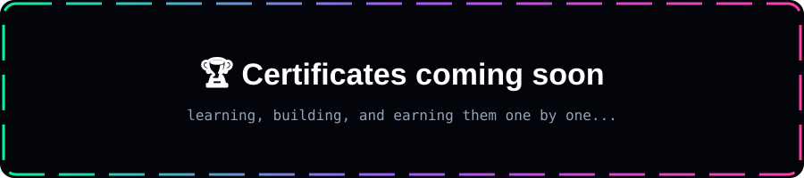

---

## 👨‍💻 About Me

- 💼 Check out my portfolio: [natimarketing.vercel.app](https://natisprotfolios-lcn8.vercel.app/)
- 🔭 Currently building: **web & mobile apps**
- 🌱 Learning: **Next.js · Flutter · LLM apps**
- 📫 Reach me at: [erminati085@gmail.com](mailto:erminati085@gmail.com)

---

## 🌐 Connect with Me

  
  
  

---

## 🛠️ Tech Stack

  

---

## 💬 Random Dev Quote

  

---

## 📊 GitHub Stats

  
  
  

### 📈 Contribution Graph

  

### 🐍 Contribution Snake

  <picture>
    <source media="(prefers-color-scheme: dark)" srcset="https://raw.githubusercontent.com/Natananse/natananse/output/github-snake-dark.svg" />
    
  </picture>

---

## 🏆 Trophies

  

---

  
  ⭐ If you like this profile, give it a star · Made with 💚 by Natananse

